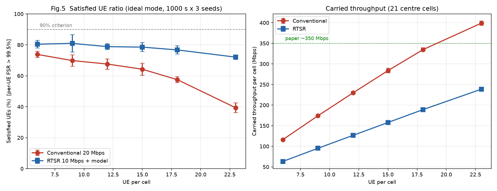
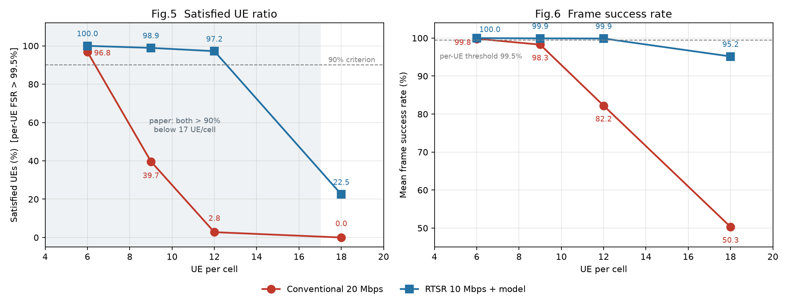

# RTSR 复现（WCNC 2023）

> *Real-Time Super-Resolution: A New Mechanism for XR over 5G-Advanced*（IEEE WCNC 2023）
> 的复现工程：**算法层**（轻量超分 + 在线训练）+ **网络层**（ns-3 + 5G-LENA，21 cell / 100 MHz / DDDSU）。

## 结论速览

| 指标 | 论文 | 本复现 |
|---|---|---|
| 6 UE/cell 满意率（传统 / RTSR）| 都 >90% | **96.83% / 99.21%** ✅ |
| 12 UE/cell 满意率 | 都 >90% | **传统 2.78% / RTSR 88.10%** ⚠️ 传统提前崩 |
| 18 UE/cell 满意率 | 传统崩塌 | 传统 **0%** ✅ |
| 拐点位置 | 17–18 | **~7（传统）/ ~12.5（RTSR）**（容量 190 vs 论文 250–360 Mbps）|
| **阶段二：理想档容量**（`sl/`）| ~350 Mbps | **399 Mbps** ✅ |
| **阶段二：23 UE/cell 满意率** | RTSR 明显优 | **传统 39.3% / RTSR 72.0%（+32.7 pp）** ✅ |
| **阶段二：RTSR 抗负载** | 撑到 23 | 6→23 传统掉 34.5 pp，**RTSR 只掉 8.4 pp** ✅ |

**一句话**：两阶段互补——阶段一（ns-3，6 s）复现趋势并把拐点左移的根因定位到
**TDMA 调度器 + 模拟波束约束**；阶段二（`sl/`，1000 s × 3 种子）把容量推到 **399 Mbps**，
并在 23 UE/cell 处得到 **传统 39.3% vs RTSR 72.0%（+32.7 pp）**，复现了论文的核心结论。





## 文档导航

文档按**两个阶段**分开放，另有跨阶段的答辩材料。总索引见 [`docs/README.md`](docs/README.md)。

**阶段一：ns-3 + 5G-LENA（6 s 高保真）**

| 文档 | 内容 |
|---|---|
| [`stage1/01_论文与场景.md`](docs/stage1/01_论文与场景.md) | 论文参数逐项对照（唯一参数权威版）|
| [`stage1/02_实现与偏差.md`](docs/stage1/02_实现与偏差.md) | 实现决策、满意率口径、**13 条偏差总表**、踩坑清单 |
| [`stage1/03_结果与对照.md`](docs/stage1/03_结果与对照.md) | ns-3 结果数字与论文对照（唯一数字权威版）|
| [`stage1/04_执行手册.md`](docs/stage1/04_执行手册.md) | 编译、运行、看进度、排错 |

**阶段二：系统级仿真器（1000 s 统计）**

| 文档 | 内容 |
|---|---|
| [`stage2/01_设计说明.md`](docs/stage2/01_设计说明.md) | 索引到 [`sl/README.md`](sl/README.md)（10 个未定假设、两档标定）|
| [`stage2/02_结果与对照.md`](docs/stage2/02_结果与对照.md) | **M6 正式结果**、两阶段对照图、与论文的诚实对照 |
| [`stage2/03_路线与后续.md`](docs/stage2/03_路线与后续.md) | 两阶段路线状态、未完成清单 |
| [`sl/README.md`](sl/README.md) | 系统级仿真器设计 + 10 轮迭代记录（代码目录内）|

**跨阶段**

| 文档 | 内容 |
|---|---|
| [`docs/README.md`](docs/README.md) | 文档总索引（按"我想查什么"编排）+ **术语表**（SL/LD/SR/TB/PDB/FSR）|
| [`docs/05_答辩材料.md`](docs/05_答辩材料.md) | 一页纸提纲 + 详稿 + 预设问答 |
| [`docs/CHANGELOG.md`](docs/CHANGELOG.md) | **文档结构调整记录** |
| [`algorithm/README.md`](algorithm/README.md) | 算法层工具与脚本 |

## 目录结构

```
RTSR/
├── README.md              ← 结论速览 + 文档导航
├── docs/
│   ├── README.md          文档总索引
│   ├── CHANGELOG.md       结构调整记录
│   ├── stage1/            阶段一：ns-3（01-04）
│   ├── stage2/            阶段二：系统级仿真器（01-03）
│   ├── 05_答辩材料.md     跨阶段
│   └── figs/              所有图
├── sl/                    阶段二代码 + 设计文档 + 结果
├── rtsr-simulation.cc     阶段一主仿真
├── rtsr-frame-agents.h    阶段一帧源/帧宿
├── layer_stats.py         阶段一五层账本
├── scripts/               运行与校验脚本
├── results/p6/            阶段一 10 条 run
├── algorithm/             算法层（EDSR）
└── archive/               历史材料
```

## 快速开始

```bash
# 1) 编译（只需一次）
cd ~/code/ns-allinone-3.39/ns-3.39
./ns3 configure --build-profile=optimized && ./ns3 build

# 2) 跑一批（并行 3 路）
cd ~/code/EMT-Pytorch-ECCV2022
setsid nohup bash RTSR/scripts/p6_run_parallel.sh \
  RTSR/scripts/p6_manifest_batch2.txt 3 > /tmp/p6.log 2>&1 &

# 3) 看进度
bash RTSR/scripts/p6_status.sh
```

详见 [`docs/04_执行手册.md`](docs/stage1/04_执行手册.md)。

## 文档规则

1. **一个事实只在一处定义**，其他地方用链接引用；
2. 参数 → `01`；实现与偏差 → `02`；数字 → `03`；操作 → `04`；讲稿 → `05`；计划 → `06`；
3. 数字必须能从 `results/p6/summary2.csv` 复算出来，不手抄。
