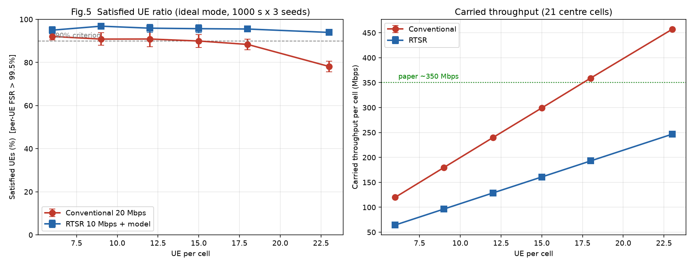
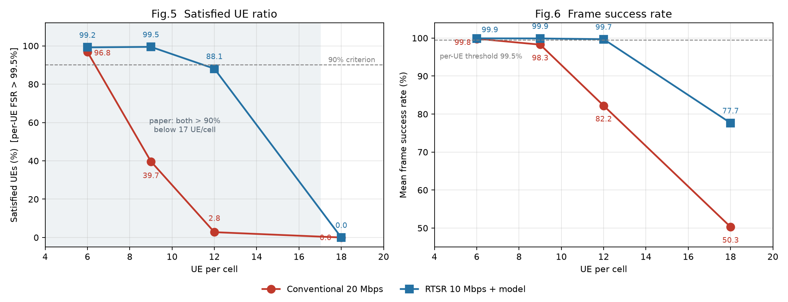

# RTSR 复现（WCNC 2023）

> *Real-Time Super-Resolution: A New Mechanism for XR over 5G-Advanced*（IEEE WCNC 2023）
> 的复现工程：**算法层**（轻量超分 + 在线训练）+ **网络层**（ns-3 + 5G-LENA，21 cell / 100 MHz / DDDSU）。

## 结论速览

| 指标 | 论文 | 本复现 |
|---|---|---|
| **阶段一**：6 UE/cell 满意率（传统 / RTSR）| 都 >90% | **96.83% / 99.21%** ✅ |
| **阶段一**：12 UE/cell 满意率 | 都 >90% | 传统 **2.78%** / RTSR **88.10%** ⚠️ 传统提前崩 |
| **阶段一**：容量 | ~350 Mbps | **191 Mbps**（TDMA + 模拟波束的天花板）|
| **阶段二**：6 UE/cell 满意率 | 都 >90% | **92.06% / 94.97%**（1000 s × 3 种子）✅ |
| **阶段二**：12 UE/cell 满意率 | 都 >90% | **90.87% / 95.90%** ✅ |
| **阶段二**：23 UE/cell 满意率 | RTSR 明显优 | **传统 78.12% / RTSR 93.93%（+15.8 pp）** ✅ |
| **阶段二**：传统拐点 | 17–18 | **14.8**（左移约 3）🟡 |
| **阶段二**：RTSR 拐点 | 23 | **>23**（23 点仍 93.93%）✅ |
| **阶段二**：90% 满意容量 | ~350 Mbps | **≈296 Mbps**（低 15%）🟡 |

**一句话**：两阶段互补——阶段一（ns-3，6 s）复现趋势并把拐点左移的根因定位到
**TDMA 调度器 + 模拟波束约束**（11 条提容量路径全部实测无效，见
[`docs/stage1/06_ns3容量探查.md`](docs/stage1/06_ns3容量探查.md)）；阶段二（`sl/`，
1000 s × 3 种子，36 条）把 90% 满意容量推到 **≈296 Mbps**，在 23 UE/cell 处得到
**传统 78.12% vs RTSR 93.93%**，复现了论文的核心结论。

> 阶段二的数据全部是 2026-11-17 完成的 1000 s × 3 种子正式结果
> （`sl/results/m6/summary_m6.csv`）。2026-11-10 的旧数据（满意率 39–80%、容量 399）
> 已被模型修复作废，归档在 `sl/results/m6_icic0/`。





## 文档导航

文档按**两个阶段**分开放，另有跨阶段的答辩材料。总索引见 [`docs/README.md`](docs/README.md)。

**阶段一：ns-3 + 5G-LENA（6 s 高保真）**

| 文档 | 内容 |
|---|---|
| [`stage1/01_论文与场景.md`](docs/stage1/01_论文与场景.md) | 论文参数逐项对照（唯一参数权威版）|
| [`stage1/02_实现与偏差.md`](docs/stage1/02_实现与偏差.md) | 实现决策、满意率口径、**14 条偏差总表**、踩坑清单 |
| [`stage1/03_结果与对照.md`](docs/stage1/03_结果与对照.md) | ns-3 结果数字与论文对照（唯一数字权威版）|
| [`stage1/04_执行手册.md`](docs/stage1/04_执行手册.md) | 编译、运行、看进度、排错 |
| [`stage1/05_FSR口径说明.md`](docs/stage1/05_FSR口径说明.md) | **FSR 判在哪一层、怎么算**（唯一口径权威版）|

**阶段二：系统级仿真器（1000 s 统计）**

| 文档 | 内容 |
|---|---|
| [`stage2/01_设计说明.md`](docs/stage2/01_设计说明.md) | 索引到 [`sl/README.md`](sl/README.md)（10 个未定假设、两档标定）|
| [`stage2/02_结果与对照.md`](docs/stage2/02_结果与对照.md) | **M6 正式结果**、两阶段对照图、与论文的诚实对照 |
| [`stage2/03_路线与后续.md`](docs/stage2/03_路线与后续.md) | 两阶段路线状态、未完成清单 |

**阶段三：容量与 FSR 拉齐论文（进行中）**

| 文档 | 内容 |
|---|---|
| [`stage3/README.md`](docs/stage3/README.md) | 三个目标与当前差距 |
| [`stage3/01_差距分析.md`](docs/stage3/01_差距分析.md) | 容量上限推导、论文口径推断、FSR 天花板根因 |
| [`stage3/02_实验计划.md`](docs/stage3/02_实验计划.md) | P0–P4 任务、验收标准、机时预算 |
| [`stage3/03_总结.md`](docs/stage3/03_总结.md) | **阶段三总结**（可独立阅读）|
| [`sl/README.md`](sl/README.md) | 系统级仿真器设计 + 10 轮迭代记录（代码目录内）|

**跨阶段**

| 文档 | 内容 |
|---|---|
| [`docs/README.md`](docs/README.md) | 文档总索引（按"我想查什么"编排）+ **术语表**（SL/LD/SR/TB/PDB/FSR）|
| [`docs/05_答辩材料.md`](docs/05_答辩材料.md) | 一页纸提纲 + 详稿 + 预设问答 |
| [`docs/CHANGELOG.md`](docs/CHANGELOG.md) | **文档结构调整记录** |
| [`algorithm/README.md`](algorithm/README.md) | 算法层工具与脚本 |

## 目录结构

```
RTSR/
├── README.md              ← 结论速览 + 文档导航
├── docs/
│   ├── README.md          文档总索引
│   ├── CHANGELOG.md       结构调整记录
│   ├── stage1/            阶段一：ns-3（01-04）
│   ├── stage2/            阶段二：系统级仿真器（01-03）
│   ├── 05_答辩材料.md     跨阶段
│   └── figs/              所有图
├── sl/                    阶段二代码 + 设计文档 + 结果
├── rtsr-simulation.cc     阶段一主仿真
├── rtsr-frame-agents.h    阶段一帧源/帧宿
├── layer_stats.py         阶段一五层账本
├── scripts/               运行与校验脚本
├── results/p6/            阶段一 10 条 run
├── algorithm/             算法层（EDSR）
└── archive/               历史材料
```

## 快速开始

```bash
# 1) 编译（只需一次）
cd ~/code/ns-allinone-3.39/ns-3.39
./ns3 configure --build-profile=optimized && ./ns3 build

# 2) 跑一批（并行 3 路）
cd ~/code/EMT-Pytorch-ECCV2022
setsid nohup bash RTSR/scripts/p6_run_parallel.sh \
  RTSR/scripts/p6_manifest_batch2.txt 3 > /tmp/p6.log 2>&1 &

# 3) 看进度
bash RTSR/scripts/p6_status.sh
```

详见 [`docs/04_执行手册.md`](docs/stage1/04_执行手册.md)。

## 文档规则

1. **一个事实只在一处定义**，其他地方用链接引用；
2. 参数 → `01`；实现与偏差 → `02`；数字 → `03`；操作 → `04`；讲稿 → `05`；计划 → `06`；
3. 数字必须能从 `results/p6/summary2.csv` 复算出来，不手抄。
