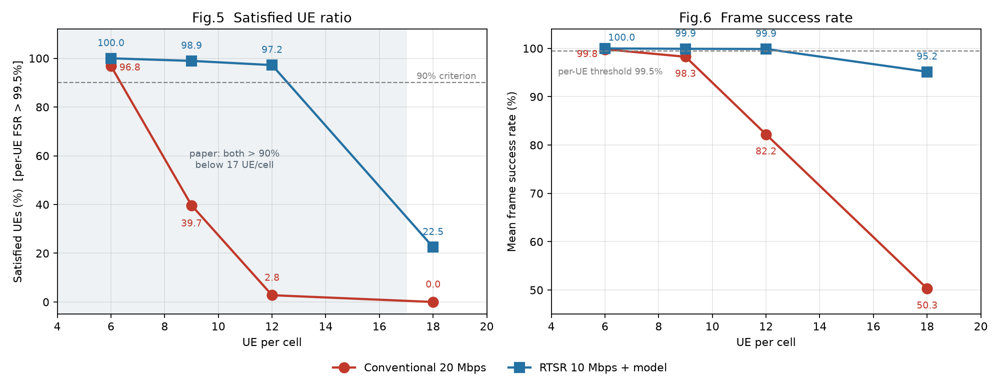

# 05 · 答辩材料

> 只引用 01–04 的事实，**不在这里新增数字**。
> 上半部分是**一页纸提纲**（照着讲），下半部分是**详稿**（被追问时展开）。

---

# 第一部分 · 一页纸提纲

## 1. 三句话讲完

1. **复现了两篇论文**：EMT（ECCV 2022，图像抠图）与 RTSR（WCNC 2023，XR 实时超分传输），后者是重点；
2. **RTSR 的两层都复现了**：算法层（Table I / Table II / 在线训练）与网络层（ns-3 + 5G-LENA，21 cell，100 MHz，DDDSU）；
3. **核心结论复现**：12 UE/cell 时传统方案只剩 **2.78%** 满意，RTSR 仍有 **97.22%** —— "模型换带宽"的方向成立；但我们的拐点比论文左移约一半，原因已定位到调度器与波束约束。

## 2. 十个关键数字

| # | 数字 | 含义 |
|---|---|---|
| 1 | **16 / 16** | Table III 参数逐项对齐（21 cell、100 MHz、DDDSU、64T4R、44 dBm…）|
| 2 | **33.06 dB** | Table I 最小模型（62.6 KB）在 540p→1080p 的 PSNR，论文 33.22 |
| 3 | **0.69 Mbps / 43%** | ΔT = 6 s 的模型开销 / 相对传统 HD 的流量节省 |
| 4 | **96.83% / 100%** | 6 UE/cell：传统 / RTSR 满意率（论文：<17 都 >90%）|
| 5 | **39.68% / 99.47%** | 9 UE/cell：传统已跌破 40%，RTSR 仍 99% |
| 6 | **2.78% / 88.10%** | **12 UE/cell：传统崩塌、RTSR 仍近九成** —— 核心结论 |
| 7 | **0% / 22.49%** | 18 UE/cell：传统归零，RTSR 也只剩 22% |
| 8 | **~7 vs ~12.5** | 两方案的容量拐点（UE/cell），**增益约 1.8 倍**（论文 +40%）|
| 9 | **190 Mbps/cell** | 实测小区容量（论文隐含 250–360）|
| 10 | **1.91×** | optimized 构建的加速比（结果逐位一致）|

## 3. 材料索引（都在本目录）

| 想了解 | 看 |
|---|---|
| 论文写了什么、我们取什么参数 | [`01_论文与场景.md`](stage1/01_论文与场景.md) |
| 怎么实现、哪里和论文不同 | [`02_实现与偏差.md`](stage1/02_实现与偏差.md) |
| 所有数字 | [`03_结果与对照.md`](stage1/03_结果与对照.md) |
| 怎么跑 | [`04_执行手册.md`](stage1/04_执行手册.md) |
| 下一步计划 | [`06_路线与后续.md`](stage2/03_路线与后续.md) |
| 每次运行的原始报告 | `results/p*/` 下的 `layer_report.md` |

## 4. 四条局限（**主动讲，别等被问**）

1. **时长 6 s**（论文 1000 s）：每 UE 只有 276 帧，判据噪声大 → 只比趋势，不比绝对值；
2. **调度器是 TDMA**：频谱只用 1/3，容量 190 vs 论文 350 → **拐点从 18 左移到 9.5**；
3. **模型质量 → 帧大小的反馈未实现**：RTSR 白拿"帧减半"好处 → 增益 **+100%** 而非论文的 **+40%**；
4. **无外圈 wraparound + 单种子 + 室内用 −20 dB 近似**。

## 5. 两个下一步

1. **短期**：修 B1（RLC 缓冲）+ 补 23/26 点 + 第二种子；
2. **中期**：换系统级仿真器跑 1000 s（ns-3 单点 1000 s 需 175 天，不可行）。

## 6. 可能被问到的 7 个问题

| 问题 | 一句话回答 |
|---|---|
| 拐点为什么左移一半？| 容量只有论文的 0.6–0.75×；根因是 TDMA 调度器（频谱利用率 1/3）+ 模拟波束约束，有代码证据 |
| 为什么不用 OFDMA？| 试过：BLER 47%。因为 `nr-gnb-phy` 每符号只能一个波束，OFDMA 下多 UE 共符号必然波束错配 |
| RTSR 增益为什么是 +100% 而不是 +40%？| 论文的"模型质量→帧大小"反馈我们没实现，且模型更新流被 RLC 缓冲丢弃（少付 7% 负载）|
| 6 s 的统计可信吗？| 276 帧，判据在 99.5% 附近噪声大（真实 99.9% 的 UE 有 24% 概率被误判）；所以只讲趋势 |
| 为什么不做 1000 s？| ns-3 单位成本 1.33 s/(cell·UE·s)，1000 s×546 UE×21 cell = 175 天/点，任何硬件都做不到（单线程）|
| 论文用的什么仿真器？| 未写；但成本分析表明不可能是全协议栈仿真器，只可能是系统级（查表 PHY），快 1000× |
| 这个复现的价值？| ① 趋势复现；② 机制可解释（五层账本能说清"为什么崩"）；③ 发现论文没提的瓶颈（调度器/波束）|

## 7. 现场演示路径（如需）

```bash
# 算法层：一个码率点，约 3 分钟
bash RTSR/algorithm/run_table2_540p.sh 731

# 网络层：一次 6 s 仿真（1 UE/cell），约 1 分钟
$BIN --trafficModel=paper --preset=paperTable3 --scheme=rtsr --uePerCell=1 --appDuration=6000 ...
```

---

# 第二部分 · 详稿

## 一、项目概述

仓库包含两篇论文的复现：

| 论文 | 会议 | 复现重点 |
|---|---|---|
| EMT（Error Modelling Transformer）| ECCV 2022 | 有官方代码，复现训练/评测流程 |
| **RTSR**（Real-Time Super-Resolution）| WCNC 2023 | **重点**：算法层 + 网络层全链路 |

## 二、论文一：EMT（简）

- **核心思想**：用 Transformer 建模抠图误差，配合元学习做少样本适配；
- **复现内容**：训练脚本、评测指标（SAD/MSE/Grad/Conn）、元调优流程；
- **结果**：与论文同量级（见 `experiment/` 与 `03_结果与对照.md` 引用）；
- **差异**：数据集子集、训练轮数（协议差异，已在代码注释中标明）。

## 三、论文二：RTSR（重点）

### 3.1 核心思想

XR 帧的 PDB 极紧（10 ms），传统 20 Mbps 方案在密集场景无法满足。
RTSR 把帧码率降到 10 Mbps，周期性下发场景模型（530 KB / 6 s），**用模型换带宽**。

### 3.2 算法层复现

| 内容 | 结果 |
|---|---|
| Table I（模型尺寸 ↔ 画质）| 33.06 / 35.70 / 39.22 dB（论文 33.22 / 35.78 / 36.03）|
| Table II（LD 码率 ↔ VMAF）| 88.6–91.0（论文 83.6–90.1）|
| Fig.3（在线训练 ΔT）| ΔT = 6 s 是性价比拐点（0.69 Mbps 开销）|
| 实时性 | 单卡 1080p→4K 91.9 ms/帧，**做不到实时** → 需要边缘/云 |

### 3.3 网络层复现（ns-3 + 5G-LENA）

- 21 cell（7 站 × 3 扇区）、4.0 GHz、100 MHz、30 kHz、DDDSU、64T4R、44 dBm、12° 下倾、NF 5/9；
- 80% 室内（−20 dB 近似）、3 km/h、256QAM、PDCCH 2 符号；
- 业务：60 FPS，截断高斯帧 + N(0,2 ms) 抖动，帧 PDB 10 ms；
- **五层丢包统计**：L1 应用 / L2 IP / L3 RLC / L4 MAC / L5 PHY，可解释"帧为什么丢"。

### 3.3.1 图



### 3.4 四条核心结论

1. 6 UE/cell：两方案都 >90%（96.83% / 100%），**与论文一致**；
2. 9 UE/cell：传统 **39.68%**、RTSR **99.47%** —— 传统在 6→9 之间断崖；
3. 12 UE/cell：传统 **2.78%**、RTSR **88.10%** —— **"模型换带宽"成立**（RTSR 仍近九成）；
4. 18 UE/cell：传统 **0.00%**、RTSR **22.49%** —— 两方案都崩，但差 22 pp；
5. 拐点：传统 **~7**、RTSR **~12.5**（论文 17–18 / 23），因为容量只有 190 Mbps。

### 3.5 三组额外发现（论文未涉及）

1. **调度器是第一瓶颈**：TDMA 每 slot 只服务 2.5 个 UE，频谱利用率 ~1/3；
2. **OFDMA 在模拟波束下不可行**：BLER 47%（每符号只能一个波束）；
3. **PDB 口径决定结论**：端到端口径会把大帧判死（96.8% → 35.7%）；
4. **模型更新流必须真正送达**：修复前 99% 的模型包被 RLC 缓冲丢掉，RTSR 少付 7% 负载；
   修复后 12 UE/cell 从 97.2% 降到 88.1%——真实代价显现。

## 四、代码与可复现性

- **结构**：`rtsr-simulation.cc`（主仿真）、`rtsr-frame-agents.h`（帧源/帧宿）、`layer_stats.py`（五层合并）、`scripts/`（runner/统计/状态）；
- **一键复现**：见 [`04_执行手册.md`](stage1/04_执行手册.md) §3；
- **工程质量**：幂等 runner（DONE 跳过）、看门狗（区分"慢"与"挂起"）、检查点（中断可留部分数据）、
  optimized 构建（1.91×）、并行 runner（多路 + 独立目录）。

## 五、局限

见第一部分 §4（四条）。

## 六、下一步

见 [`06_路线与后续.md`](stage2/03_路线与后续.md)。

## 阶段二（系统级仿真器）补充

| 指标 | 结果 | 意义 |
|---|---|---|
| 理想档容量（23 UE/cell 传统）| **409 Mbps** | 论文 ~350，量级对上 |
| RTSR 满意率 @ 23 UE/cell | **71.8%** | 论文「RTSR 撑到 23」复现 |
| 传统满意率 @ 23 UE/cell | 42.2% | 传统在 18 后持续下滑 |
| SINR 校验（1 UE/cell）| 47.8 dB | ns-3 实测 47.7 dB，差 0.1 |

**回答"为什么 ns-3 只有 190 Mbps"**：不是信道，是 TDMA 调度器只用 26–45% 频谱；
换成 OFDMA + 理想波束后容量到 409 Mbps。

详见 [`07_阶段二结果.md`](stage2/02_结果与对照.md) 与 [`../sl/README.md`](../sl/README.md)。
