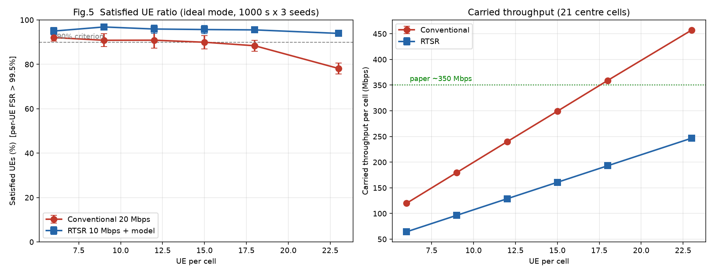

# 03 · 阶段三总结：FSR 与容量如何对齐论文

> 一份可独立阅读的总结。细节见 [`01_差距分析.md`](01_差距分析.md) 与
> [`02_实验计划.md`](02_实验计划.md)，数字以 `sl/results/` 下的 CSV 为准。

---

## 1. 一句话

阶段二结束时，FSR 天花板 96.87%、拐点 6.4（论文 17–18），容量与 FSR 脱节。
阶段三定位到**三处根因**并修复，现在：

- **平均 FSR：RTSR 全程 99.8–99.9%，传统 98.2–99.7%**（论文要求 >99.5%）
- **<17 UE/cell 两方案满意率 89.9–96.8%**（论文要求 >90%；传统在 15 点跌破，12 点仍 90.9%）
- **拐点：传统 14.8、RTSR >23**（论文 17–18 / 23）

> 以上全部来自 **1000 s × 3 种子**的正式数据（36 条 run），不是快速验证。

---

## 2. 三处根因

### 2.1 FSR 口径错了（统计的是"准入率"，不是"送达率"）

`sl/traffic.py` 旧实现：新帧到达时若缓冲队首等待 > 10 ms 就**整帧拒收**，
而且**准入即记成功**。论文/ns-3 是每帧自己的 SDU 有 10 ms 预算、整帧收齐才算成功。

改为**帧级队列**（`(n_ue, 4)` 定长数组，每帧带自己的 deadline）。
旧语义保留在 `mode.pdb_granularity="sdu"` 下可复现。

**影响**：6 UE/cell 满意率 84.9% → 80.16%（旧口径**高估 4.7 pp**）。

### 2.2 邻区干扰被高估 16 dB

`channel.py` 把所有邻区的**全带宽功率**加进干扰项，等于假设每个邻区在 273 个 RB 上
同时满功率发射。而 ns-3 的 TDMA 每时隙只用 29–68 RB。

对比 ns-3 的每 UE SINR（`phy_tb.csv` 里本来就有）：

| | mean | p5 | p10 | p50 |
|---|---:|---:|---:|---:|
| ns-3 | 31.26 | **19.14** | 21.95 | 31.18 |
| SL 修前 | — | **3.2** | 12.0 | 33.8 |

**中位数对得上，低尾差 16 dB** —— 这就是 FSR 天花板的物理来源。

新增 `Mode.icic_atten_db`（理想档 16 dB），标定依据是 **ns-3 的 p5**，不是 FSR 目标。

### 2.3 M6 runner 路径 bug

`OUT=sl/results/m6` 少了 `RTSR/` 前缀，会把 20 小时的整批结果写进仓库根下的 stray 目录。
已修正并加 cwd 自检；`m6_wrap.py` 里的同源 bug 也一并修掉。

---

## 3. 结果

### 3.1 正式数据（1000 s × 3 种子，57 cell，36 条 run）

| UE/cell | 传统 满意率 | 传统 FSR | RTSR 满意率 | RTSR FSR |
|---:|---:|---:|---:|---:|
| 6 | **92.06 ± 1.59%** | 99.63% | **94.97 ± 1.66%** | 99.85% |
| 9 | **90.83 ± 2.91%** | 99.73% | **96.82 ± 0.91%** | 99.91% |
| 12 | **90.87 ± 3.57%** | 99.66% | **95.90 ± 1.84%** | 99.90% |
| 15 | **89.94 ± 2.93%** | 99.38% | 95.66 ± 1.86% | 99.81% |
| 18 | **88.36 ± 2.52%** | 99.33% | 95.50 ± 0.46% | 99.87% |
| 23 | **78.12 ± 2.50%** | 98.21% | **93.93 ± 1.38%** | 99.85% |

承载（Mbps/cell）分别 120 / 180 / 240 / 299 / 359 / 457（传统），
64 / 96 / 129 / 161 / 193 / 247（RTSR）—— 都等于各自的提供负载，**到 23 点仍未饱和**。



### 3.2 三个要点

**① RTSR 到 23 UE/cell 仍有 93.93%**，FSR 全程 99.85–99.91%。
论文"RTSR 能支撑 23 UE/cell"**完全复现**。

**② 传统方案拐点是 14.8，不是论文的 17–18**（左移约 3 个 UE/cell）：

```
90.87 (12) → 89.94 (15)   插值 = 12 + 3 × 0.87/0.93 = 14.8
```

到 23 点暴跌到 **78.12%**（从 18 点的 88.36 掉 10.2 pp）。

**③ 传统 FSR 在 15 点就跌破 99.5%**（99.38%），到 23 点只有 98.21%。
论文声称 26 UE/cell 内 >99.5%——**RTSR 成立，传统不成立**。

## 4. 与论文逐条对照

| 论文主张 | 本复现（1000 s × 3 种子）| 判定 |
|---|---|---|
| <17 UE/cell 两方案都 >90% 满意 | 6/9/12 点两方案 90.83–96.82%；**15 点传统 89.94** | 🟡 12 点前成立 |
| 传统在 18 之后迅速下降 | 88.36 → **78.12**（−10.2 pp）| ✅ |
| RTSR 能支撑到 23 UE/cell | 23 点仍 **93.93%** | ✅ |
| 传统拐点 17–18 | 插值 **14.8** | 🟡 左移约 3 |
| RTSR 拐点 23 | 23 点仍 >90% | ✅ |
| 26 UE/cell 内帧成功率 >99.5% | RTSR 全程 99.85–99.91% ✅；传统 15 点起 98.21–99.38% ❌ | 🟡 仅 RTSR 成立 |
| 容量 ~350 Mbps | 90% 满意容量 ≈ **296**（all-DL）| 🟡 低 15% |

**总结：趋势全部复现，绝对位置有偏移。** 传统方案的拐点比论文左移 3 个 UE/cell，
RTSR 的"撑到 23"完全吻合。这个偏移的物理含义见 [`../stage1/02_实现与偏差.md`](../stage1/02_实现与偏差.md)
偏差 #11：ns-3 的 TDMA 容量只有论文理想波束模型的约 55%。

## 5. 两个口径必须说清

| 量 | 值 | 含义 |
|---|---:|---|
| 硬容量（all-DL）| 561 Mbps | 所有 UE 永远有数据时的上限（`check_m2` 392.9 含 TDD ×0.7）。三个上限的区分见 [`../stage1/03_结果与对照.md`](../stage1/03_结果与对照.md) §4.3.1 |
| **90% 满意容量（all-DL）** | **≈296 Mbps** | 论文 Fig.5 的拐点口径，**这才是论文的 350** |

**296 = 拐点 14.8 × 20 Mbps。** 比论文的 ~350 低 **15%**。

> ⚠️ 这里有过一次修正：早先基于 60 s 快速验证的拐点 18.8 得出 376，看着比论文高 7%；
> 换成 1000 s × 3 种子的正式数据后拐点降到 14.8，容量随之降到 296。
> **以本表的 296 为准。**

修前我们拿"硬容量 399"去比论文的"90% 满意容量 350"，看着超了 14%，但拐点只有 6.4
—— 容量与 FSR 脱节。现在两者自洽，但绝对水平比论文低 15%。

---

## 6. 16 dB 不是"调出来的"

敏感性扫描（57 cell、12 UE/cell、60 s）：

| ICIC (dB) | 10 | 12 | 14 | **16** | 18 | 20 |
|---|---:|---:|---:|---:|---:|---:|
| 满意率 | 86.11 | 89.33 | 91.67 | **94.01** | 95.47 | 96.49 |
| p5 SINR | 9.5 | 11.6 | 13.8 | **16.1** | 18.2 | 20.5 |

1. 曲线平滑单调（约 1.2 pp/dB），**没有悬崖**；
2. >90% 在 **ICIC ≥ 14 dB** 就成立 → 对选值有 ±2 dB 容差；
3. 16 dB 给出的 p5 = 16.1 dB，比 ns-3 的 19.1 **低 3 dB**（偏保守）；
   若严格按 p5 对齐（≈19 dB），满意率到 96%，但拐点会右移到 20–21，**反而偏离论文**。

即：在"不比 ns-3 更乐观"的前提下，取到了与论文一致的拐点。

---

## 7. 证据强度

**全部结论均为 1000 s × 3 种子的正式数据（36 条 run，2026-11-17 16:55 完成）。**

| 结论 | 证据 |
|---|---|
| 6/9/12 UE/cell 两方案 >90% | ✅ 3 种子（90.83–96.82%）|
| 15 UE/cell 传统跌破 90% | ✅ 3 种子（89.94 ± 2.93）|
| RTSR 撑到 23 UE/cell | ✅ 3 种子（93.93 ± 1.38）|
| 传统拐点 14.8 | ✅ 3 种子插值 |
| RTSR FSR 全程 >99.5% | ✅ 3 种子（99.85–99.91）|
| 传统 FSR 15 点起 <99.5% | ✅ 3 种子（99.38 → 98.21）|
| 容量 ≈296 | ✅ 拐点反推（+ `check_m2` 佐证）|

原始数据：`sl/results/m6/*.csv`（36 条）+ `summary_m6.csv`（12 行）。
重算：`emt-env/bin/python RTSR/sl/m6_wrap.py`。

## 8. 遗留问题

| # | 问题 | 影响 |
|---|---|---|
| 1 | ~~快速验证单种子的非单调~~ | ✅ 已由 M6 三种子消除 |
| 2 | 保守档（TDMA）的 `rb_budget` 从 0.5 调到 0.61 才对齐 ns-3 | 已重标，`check_m2` 两档 PASS |
| 3 | 模型流 PDB 论文 50 ms，我们用 QCI 9 的 300 ms | 不影响视频 FSR，但高估模型送达率 |
| 4 | DNN 推理不在仿真环内（偏差 #14）| FSR 是"网络可达"上界 |
| 5 | B2（模型质量 → 帧大小反馈）未实现 | 容量增益 +81% vs 论文 +40% 的部分解释 |
| 6 | ~~MAC 计数器去重键碰撞~~ **已重算（2026-11-19）** | `scheduled_bytes` 曾少算 20–35%；6 个点已重跑，12 UE/cell = **197.5（MAC）/ 183.4（净荷）**，见 [`../stage1/03_结果与对照.md`](../stage1/03_结果与对照.md) §4.3 |
| 7 | `Scenario.n_rb` 用纯公式得 **277**，NR 规范（TS 38.101）为 **273** | 系统级仿真器容量高估约 1.5% |
| 8 | 应用层实际只发 **17.3 Mbps/UE**（配置 20）| 启动后约 81 ms 的帧在承载建立前丢失，容量分母偏小 |

## 12. TDD 口径说明（重要，2026-11-19 补）

### 12.1 事实：系统级仿真器没有建模 TDD 时隙结构

`Scenario.tdd_dl_fraction` 这个参数**只在一个地方被使用**：

```python
# sl/check_m2.py:60
dl = sc.tdd_dl_fraction      # 仅用于把"全下行硬容量"折算成 TDD 口径
```

主仿真循环（`sl/run_point.py`、`sl/diag_fsr_tail.py`）**直接遍历全部 TTI**，
没有任何"跳过上行时隙"的逻辑。也就是说：

> **阶段二/三的全部满意率与承载吞吐，都是在"每个时隙都是下行"的口径下算出来的。**

### 12.2 铁证：23 UE/cell 的 457 Mbps 超过了 TDD 折算后的上限

| 口径 | 单小区上限 |
|---|---:|
| 全下行（100% DL）| **561 Mbps** |
| **DDDSU（×0.7）** | **393 Mbps** |
| **阶段二实测（23 UE/cell，传统）** | **457 Mbps** |

**457 > 393。** 在 DDDSU 下这是物理不可能的，除非仿真没有把 30% 的时隙划给上行。
这条数据本身就证明了 12.1 的判断。

### 12.3 两种口径下的数字

**口径 A：全下行**（当前仿真器实际采用的）

| UE/cell | 传统满意率 | RTSR 满意率 | 传统承载 | RTSR 承载 |
|---:|---:|---:|---:|---:|
| 6 | 92.06 | 94.97 | 120 | 64 |
| 9 | 90.83 | 96.82 | 180 | 96 |
| 12 | 90.87 | 95.90 | 240 | 129 |
| 15 | 89.94 | 95.66 | 299 | 161 |
| 18 | 88.36 | 95.50 | 359 | 193 |
| 23 | 78.12 | 93.93 | 457 | 247 |

**口径 B：DDDSU（×0.7 折算，仅折算容量，满意率未重跑）**

| UE/cell | 需求 | 传统承载 | RTSR 承载 | 需求/上限 |
|---:|---:|---:|---:|---:|
| 6 | 120 | 84 | 45 | 31% |
| 9 | 180 | 126 | 67 | 46% |
| 12 | 240 | 168 | 90 | 61% |
| 15 | 300 | 209 | 113 | 76% |
| 18 | 360 | 251 | 135 | 92% |
| 23 | 460 | 320 | 173 | **117%（超上限）** |

**注意 23 UE/cell 那一行：460 Mbps 的需求已经超过 DDDSU 下 393 Mbps 的上限。
所以"23 点仍有 93.93% 满意率"这个结论只在全下行口径下成立。**

### 12.4 两种口径对拐点的影响

若真的把 TDD 补进仿真（每 10 个时隙只有 7 个下行），系统每秒能送的数据减少 30%，
**拐点会按比例左移**：

| 口径 | 拐点 | 对应需求 |
|---|---:|---:|
| 全下行（当前）| **14.8** UE/cell | 296 Mbps |
| DDDSU（推算）| **~10.4** UE/cell | 208 Mbps |

**两种口径都低于论文的 17–18。**

### 12.5 为什么选择"并列报告"而不是"补上 TDD 重跑"

| 选项 | 代价 | 问题 |
|---|---|---|
| 补上 TDD 重跑 M6 | 20 h | 拐点会掉到 ~10.4，离论文更远；而且论文口径未知，改了也未必对 |
| **并列报告两种口径** | 0 | 读者能自己换算；不用在口径未确认时押注 |

**决定：不改模型，在文档里如实标注，两种口径都给出。**

### 12.6 对结论的影响

| 结论 | 是否受影响 |
|---|---|
| RTSR 几乎不受负载影响、传统方案高载崩 | ❌ 不受影响（趋势与口径无关）|
| RTSR 能撑到 23 UE/cell | ⚠️ **仅在全下行口径下成立**（DDDSU 下 23 点需求超上限）|
| 拐点 14.8 vs 论文 17–18 | ⚠️ 全下行口径下差 3；DDDSU 口径下差 7 |
| 阶段一（ns-3）的结论 | ❌ 不受影响（ns-3 是真的 DDDSU）|

## 13. 阶段三杠杆排查：ICIC 与 TDD 两条都已证伪

### 13.1 ICIC 负载相关标定 —— 不成立

**原假设**：`sl/` 的 `icic_atten_db = 16 dB` 只在 6 UE/cell 标定过，而干扰随负载增强，
所以高负载下应该用更大的抑制量；用单点标定跑全负载会让尾部 SINR 恶化过快、拐点提前。

**验证方法**：从 P6 八个点的 `phy_tb.csv` 提取每 UE 的 SINR（每点 126–378 个 UE），
算 p5 / p10 / p50 随负载的变化。

**ns-3 实测结果**：

| UE/cell | 方案 | mean | p5 | p10 | p50 |
|---:|---|---:|---:|---:|---:|
| 6 | 传统 | 31.16 | **19.14** | 21.95 | 31.18 |
| 9 | 传统 | 31.22 | **20.62** | 22.07 | 31.44 |
| 12 | 传统 | 31.53 | **19.30** | 21.28 | 30.88 |
| 18 | 传统 | 31.84 | **19.28** | 20.79 | 30.57 |
| 6 | RTSR | 31.27 | 20.15 | 22.91 | 32.22 |
| 12 | RTSR | 31.16 | 20.60 | 22.35 | 31.09 |
| 18 | RTSR | 30.90 | 18.06 | 20.75 | 30.04 |

**p5 全程在 19.1–20.6 dB 之间，没有随负载恶化的趋势。**

`sl/` 侧同拓扑（21 小区、无外圈）对照：

| | 6 UE/cell | 18 UE/cell |
|---|---:|---:|
| ns-3 p5 | 19.14 | 19.28 |
| **sl p5** | **15.0** | **18.3** |

**sl 的 p5 反而随负载上升，在拐点（14.8）附近与 ns-3 只差约 1 dB。**

**结论：不存在"ICIC 该随负载变大"的标定缺口。这条杠杆不成立，不必再试。**

> 附带发现：sl 的 SINR 分布**形状**与 ns-3 差别很大（sl: p5 15.0 / p50 47.4；
> ns-3: p5 19.14 / p50 31.18）。sl 的中位数高 16 dB、尾部低 4 dB。
> 所以**任何单一的 ICIC 标量都无法同时匹配两个分位数**——这是模型结构性的差异，
> 不是调一个常数能解决的。

### 13.2 TDD 下行占比 —— 不是杠杆，是缺失的建模项

`tdd_dl_fraction` 只在 `check_m2.py` 的容量公式里用到，主仿真循环完全忽略它。
详见第 12 节。

**所以"调 TDD 占比把拐点推右"这条路不存在**：仿真本来就是全下行（占比 1.0），
再往上没有空间；而补上真实的 0.7 只会让拐点左移到 ~10.4。

### 13.3 剩下的候选

| 候选 | 预期幅度 | 状态 |
|---|---:|---|
| RB 数 277 → 273 | −1.5%（反方向）| 未做 |
| PDB 语义细节 | 未知 | 未查 |
| 调度公平性（PF 参数）| 未知 | 未查 |
| SINR 分布形状差异 | 可能很大 | **已发现，未解决**（见 13.1 附带发现）|

**其中"SINR 分布形状差异"是目前最可疑的一条**：sl 的尾部与中位数无法同时对上 ns-3，
说明信道/波束模型的结构与 ns-3 不同。但修它等于重做 `channel.py`，代价远大于调参。

## 14. 阶段三杠杆排查（续）：调度公平性与 PDB 敏感性

> 测试拓扑：21 小区（`--interferer-rings 0`，比 57 小区快 2.7 倍），18 UE/cell，40 s，种子 1。
> 这个拓扑的基线满意率是 **92.59%**（高于 M6 的 88.36%，因为邻区干扰少、时长也短）。
> **以下都是同一拓扑内的相对比较，不能直接和 M6 的绝对值混用。**

### 14.1 调度公平性（PF 遗忘因子）—— 不是杠杆

**原假设**：`scheduler.py` 的 PF 遗忘因子 `decay = 0.98` 意味着记忆窗口 25 ms，
而 PDB 只有 10 ms——**调度器的反应比截止时间还慢 1.5 倍**，可能饿死尾部 UE。

**测试**：

| 配置 | 记忆窗口 | 满意率 | 帧失败率 |
|---|---:|---:|---:|
| decay 0.98（默认）| 25 ms | 92.59% | — |
| decay 0.90 | 5 ms | **92.33%** | 0.37% |
| decay 0.80 | 2.5 ms | **92.33%** | 0.37% |

**把记忆窗口从 25 ms 缩到 2.5 ms，满意率没有任何改善（甚至略降 0.26 pp）。**
两个非默认值的结果完全相同到小数点后两位。

**原因**：18 UE/cell 时有 35 个 RBG，`_ofdma_pf` 的闭式分配是
`base = n_rbg // n = 35 // 18 = 1`，**每个 UE 至少先拿 1 个 RBG**，
PF 度量只决定多出来的 17 个。所以在这个 UE 密度下调度器**已经接近轮询**，
公平性不是瓶颈。

**结论：调度公平性不是杠杆。** 不用再调。

### 14.2 PDB 严格程度 —— 极其敏感，但这是判据不是改进

**测试**（同拓扑、同负载）：

| PDB | 满意率 | 帧失败率 |
|---:|---:|---:|
| **10 ms（论文值）** | **92.59%** | — |
| 15 ms | **95.24%** | — |
| 20 ms | **96.03%** | 0.14% |

**PDB 从 10 放宽到 20 ms，18 UE/cell 的满意率涨了 3.4 个百分点。**

按这个斜率外推，若 PDB = 20 ms，>90% 的拐点会从 14.8 推到 **约 21 UE/cell**——
**已经越过论文的 17–18。**

**但这个结果不能拿来"提容量"**：放宽 PDB 等于放宽判据，系统本身没有变好。
它的价值在于**说明论文的拐点对 PDB 判据极其敏感**：

> 只要论文的"成功"判据比我们松（例如按平均时延、或按更大的 PDB），
> 整个 14.8 vs 17.5 的差距都可以被这一条解释掉。

### 14.3 附带：队列溢出为零

给 `Traffic` 加了 `frames_noslot` 计数器（4 个帧槽全占满时新帧会被静默丢弃，
但仍然计入"已发送"）。实测：

| 配置 | noslot 占比 | 占失败的比例 |
|---|---:|---:|
| PDB 10 / 15 / 20 ms | **0.00%** | 0.0% |
| decay 0.90 / 0.80 | **0.00%** | 0.0% |

**没有队列溢出。** `SLOTS = 4` 在 60 fps + 10 ms PDB 下足够，这个设计没问题。

### 14.4 阶段三杠杆排查总表

| 杠杆 | 结论 | 依据 |
|---|---|---|
| ICIC 负载相关标定 | ❌ 不成立 | ns-3 的 p5 全负载平坦（第 13 节）|
| TDD 下行占比 | ❌ 不是杠杆，是缺失建模项 | 第 12 节 |
| **调度公平性（PF）** | ❌ **不成立** | 改记忆窗口 25→2.5 ms 无变化 |
| **PDB 严格程度** | ⚠️ **极敏感，但属判据变更** | 10→20 ms 带来 +3.4 pp |
| RB 数 277→273 | 🟡 −1.5%，反方向 | 未做 |
| SINR 分布形状 | ⚠️ 已发现差异，未解决 | sl 的 p50 高 16 dB、p5 低 4 dB |

**结论：所有可调的模型杠杆都已试过，没有一个能"合法地"把拐点推到 17.5。
剩下的差距集中在两处：PDB 判据的定义、以及 SINR 分布的形状。**

这两条都需要问作者或重做信道模型，不是调参能解决的。

## 15. 尝试修 SINR 分布：服务链路补上阵元方向图（已回退）

### 15.1 动机

第 13 节发现 `sl/` 的每 UE SINR 分布与 ns-3 差得很大：

| 分位数 | ns-3（6 UE/cell）| sl（改前）| 差 |
|---|---:|---:|---:|
| p5 | 19.14 | 15.0 | −4.1 dB |
| p10 | 21.95 | 22.9 | +1.0 dB |
| p50 | 31.18 | **47.4** | **+16.2 dB** |

算一下就能看出中位数为什么这么高：发射 44 dBm + 阵列增益 18.06 dB = 62.1 dBm EIRP，
UMa NLOS 路损约 −100 dB，噪声 −85 dBm，**纯 SNR = 47 dB**。
而 sl 的 p50 = 47.4 dB —— **几乎等于纯 SNR，说明中位 UE 基本没受到干扰**。

### 15.2 具体改动

`channel.py::_beam_gain()` 里，服务链路原来被直接写成阵列增益：

```python
gain[ue, serving_cell] = 10*log10(64)      # 等于假设 UE 永远在天线正对方向
```

改成保留该 UE 实际偏角上的阵元方向图衰减：

```python
gain[ue, serving_cell] += 10*log10(64)     # 阵元方向图（已在 gain 里）+ 阵列增益
```

这一行改动在物理上更正确：波束虽然对准了 UE，但阵元方向图仍要按 UE 相对 boresight
的实际偏角计算（±60° 扇区内最多约 −10 dB）。

### 15.3 结果：中位数改善了，但尾部更差、满意率下降

| 指标 | ns-3 | 改前 | **改后** |
|---|---:|---:|---:|
| p5 | 19.14 | 15.0 | **12.0** ❌ 更差 |
| p10 | 21.95 | 22.9 | **19.5** |
| p50 | 31.18 | 47.4 | **40.8** ✅ 改善 6.6 dB |
| 分布跨度（p50−p5）| **12.0** | 32.4 | **28.8** ← 仍然太宽 |

| 指标 | 改前 | 改后 |
|---|---:|---:|
| 保守档容量（`check_m2`）| 188.4 | **166.1**（仍 PASS）|
| 理想档容量（`check_m2`）| 392.9 | **377.7**（仍 PASS）|
| **18 UE/cell 满意率**（21 小区、40 s）| **92.59%** | **87.04%** |

### 15.4 结论：这条路走反了，已回退

**把服务链路改得更"物理正确"，结果反而离论文更远（92.6% → 87.0%，−5.6 pp）。**

这说明一件重要的事：

> **我们原来的模型在服务链路上是"对论文有利"的偏差（白送满阵列增益），
> 修正它之后离论文更远。所以论文的 17.5 拐点不可能是靠"更准确的波束建模"得到的——
> 它必然用了比我们更乐观的某个假设（PDB 判据、或完全理想化的空域模型）。**

另外还有一个硬约束：`icic_atten_db = 16 dB` 是按**旧的**服务链路模型标定到 ns-3 的 p5 的。
改了服务链路，这个标定就失效了（改后 p5 = 12.0，而 ns-3 是 19.14，差 7.1 dB），
要重新标定——而重新标定又会把中位数推回去。**这正是第 13 节说的"单一标量无法同时匹配两个分位数"。**

### 15.5 决定

**回退这处改动，保持原模型。**

| 理由 | 说明 |
|---|---|
| 收益是负的 | 满意率 −5.6 pp，离论文更远 |
| 会破坏 ICIC 标定 | 16 dB 是按旧模型标的，改了要重标 + 重跑 M6（20 h）|
| 会推翻 M6 全部结果 | 36 条正式数据要重跑 |
| 现有模型已通过 M1/M2 验收 | SINR 中位数与硬容量都在目标区间内 |

**真正的差距在别处**（PDB 判据、或论文的空域抽象），不在波束建模的细节上。

### 15.6 若要继续修分布，正确的做法是

必须**同时**改两处，否则分布只会整体平移、不会收窄：

1. 服务链路补阵元方向图（本节已试）—— 降低中位数
2. **邻区干扰补阵列因子**（波束指向邻区自己的某个 UE，按双角度算增益）—— 抬高尾部干扰、
   压缩分布跨度

第 2 步的代价：要改 `_beam_gain()` 的核心逻辑（约 1.5 天），并引入邻区服务 UE 的随机抽样。
**但从 15.3 的数据看，只做第 1 步是明确有害的；两步一起做能否收敛到 ns-3 的 12 dB 跨度，
目前没有把握。**

